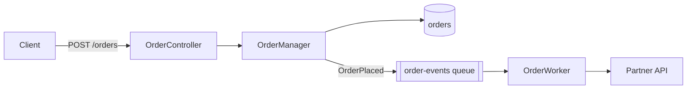
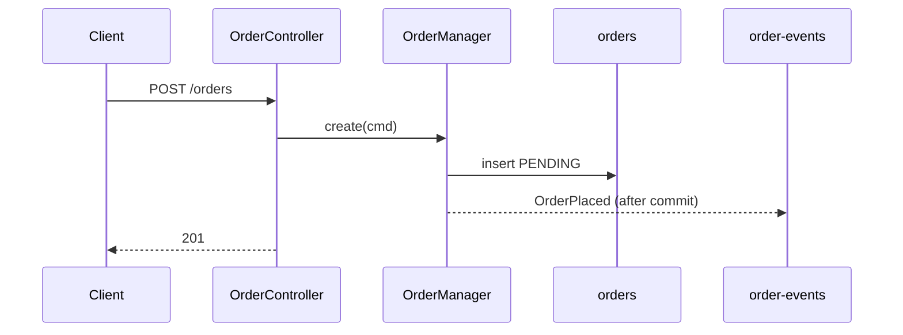
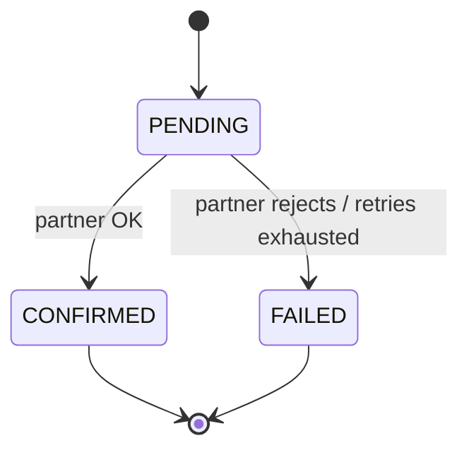

# {Feature} — Flow

How this feature works at runtime: where execution starts, every function on the path, every
way it can exit, and the low-level design underneath. All code references are clickable links
with line numbers. Kept in sync with the code at every step. Last synced: {YYYY-MM-DD}, step {N}.

## 1. In one paragraph

{Plain-English story: "When a customer submits X, the API validates it, stores a PENDING row,
publishes an event, and a worker later calls partner Y. When Y responds, the row moves to
DONE and the customer is notified." No jargon you wouldn't say out loud.}

## 2. Big picture



{For diagrams with more than ~6 nodes, async hops, or a state machine, also draw it in Excalidraw:}
**Detailed diagram:** [diagrams/flow.excalidraw](diagrams/flow.excalidraw). Open it in excalidraw.com
(File → Open) or the VS Code Excalidraw extension. Source: [diagrams/flow.json](diagrams/flow.json).

## 3. Entrypoints

Every way execution can enter this feature.

| # | Trigger | Entrypoint | Auth / guard | Notes |
|---|---|---|---|---|
| E1 | `POST /api/v1/orders` | [OrderController.create](../../src/.../OrderController.java#L42) | JWT, role `CUSTOMER` | idempotency key header |
| E2 | SQS `order-events` | [OrderWorker.handle](../../src/.../OrderWorker.java#L30) | — | deletion ON_SUCCESS |
| E3 | Cron `0 */5 * * *` | [RetryJob.run](../../src/.../RetryJob.java#L18) | — | feature flag `orders.v2` |

## 4. Call chain (happy path)

One numbered walk per entrypoint. Indentation = call depth. Each line: link, what it does, and
what it reads or writes.

### E1 — Create order

1. [OrderController.create(req)](../../src/.../OrderController.java#L42): validates the body, maps it to `CreateOrderCmd`
   1. [OrderManager.create(cmd)](../../src/.../OrderManager.java#L60): `@Transactional`
      1. [OrderDAO.findByIdempotencyKey](../../src/.../OrderDAO.java#L12): **reads** `orders`
      2. [PricingFacade.quote](../../src/.../PricingFacade.java#L25): **calls** the pricing service (retry ×3)
      3. [OrderDAO.save](../../src/.../OrderDAO.java#L8): **writes** `orders` (status `PENDING`)
      4. [EventPublisher.publish(OrderPlaced)](../../src/.../EventPublisher.java#L19): **publishes** to `order-events` *(after commit)*
2. Returns `201 {orderId, status: PENDING}`

## 5. Exits

Every way the flow can end, success or not.

| # | Exit | Condition | Where | Result for caller | State left behind |
|---|---|---|---|---|---|
| X1 | ✅ Success | happy path | [OrderManager.java#L88](../../src/.../OrderManager.java#L88) | `201` + body | row `PENDING`, event published |
| X2 | ↩️ Idempotent replay | same idempotency key | [OrderManager.java#L64](../../src/.../OrderManager.java#L64) | `200` + existing order | unchanged |
| X3 | ❌ Validation error | bad body | [OrderController.java#L45](../../src/.../OrderController.java#L45) | `400` | none |
| X4 | ❌ Pricing down | 3 retries exhausted | [PricingFacade.java#L40](../../src/.../PricingFacade.java#L40) | `503` | none (tx rolled back) |
| X5 | ☠️ Worker poison message | 5 receives | DLQ `order-events-dlq` | — | row stays `PENDING` → see bugs.md B3 |

## 6. Low-level design

### Components

| Class / module | Responsibility | Depends on |
|---|---|---|
| [OrderController](../../src/.../OrderController.java) | HTTP mapping, validation | OrderManager |
| [OrderManager](../../src/.../OrderManager.java) | Business rules, transaction boundary | OrderDAO, PricingFacade, EventPublisher |

### Key signatures

```java
OrderView create(@Valid CreateOrderCmd cmd);          // idempotent on cmd.idempotencyKey
void handle(JobAttributes<OrderPlaced> msg);         // throws → message retried
```

### Sequence



### State machine (if the feature has statuses)



### Data model

| Table / topic / key | Field | Type | Notes |
|---|---|---|---|
| `orders` | `status` | enum | see state machine |

### Errors, retries, idempotency

- {Which calls retry, how many times, with what backoff}
- {What is idempotent, and on which key}
- {Transaction boundaries: what rolls back together}

### Config & flags

| Key | Default | Effect |
|---|---|---|
| `orders.v2.enabled` | `false` | routes E1 to the new flow |
